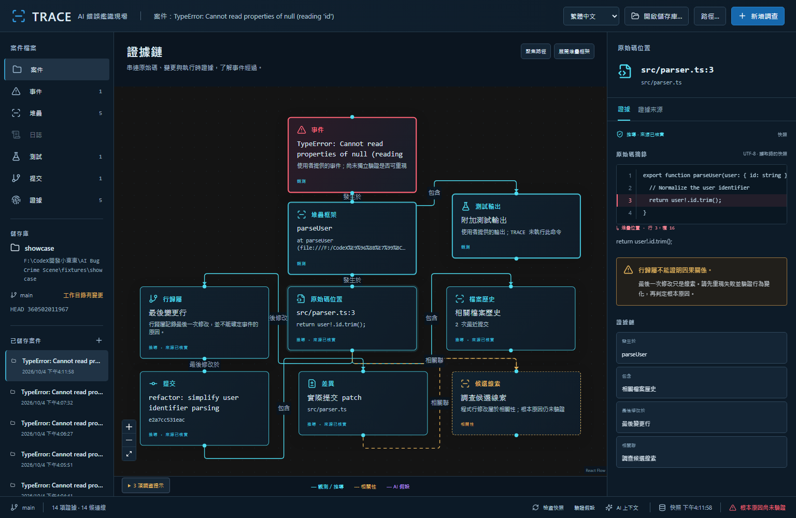
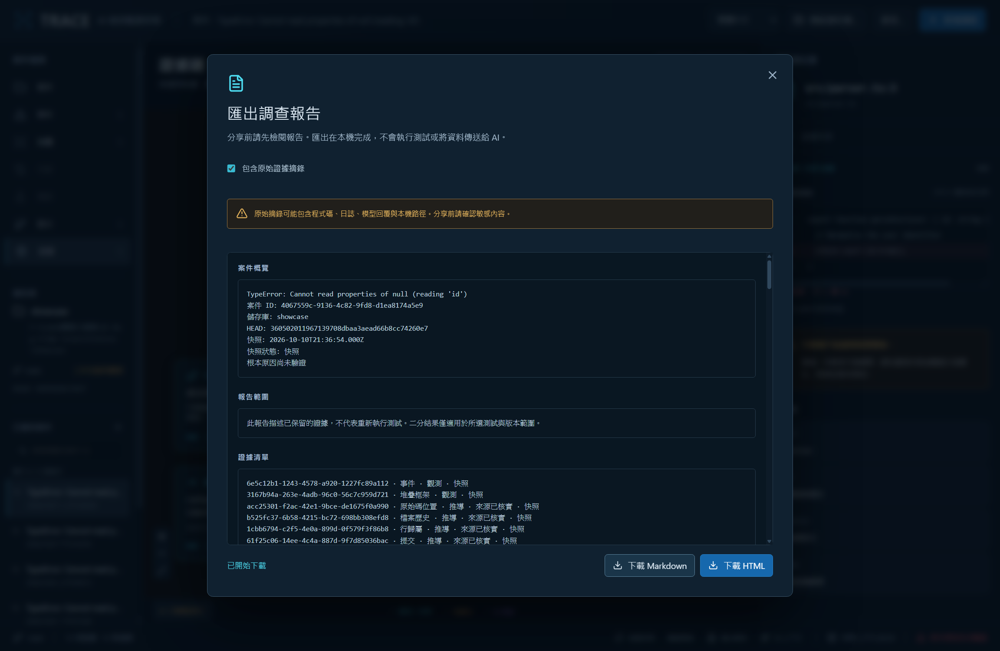
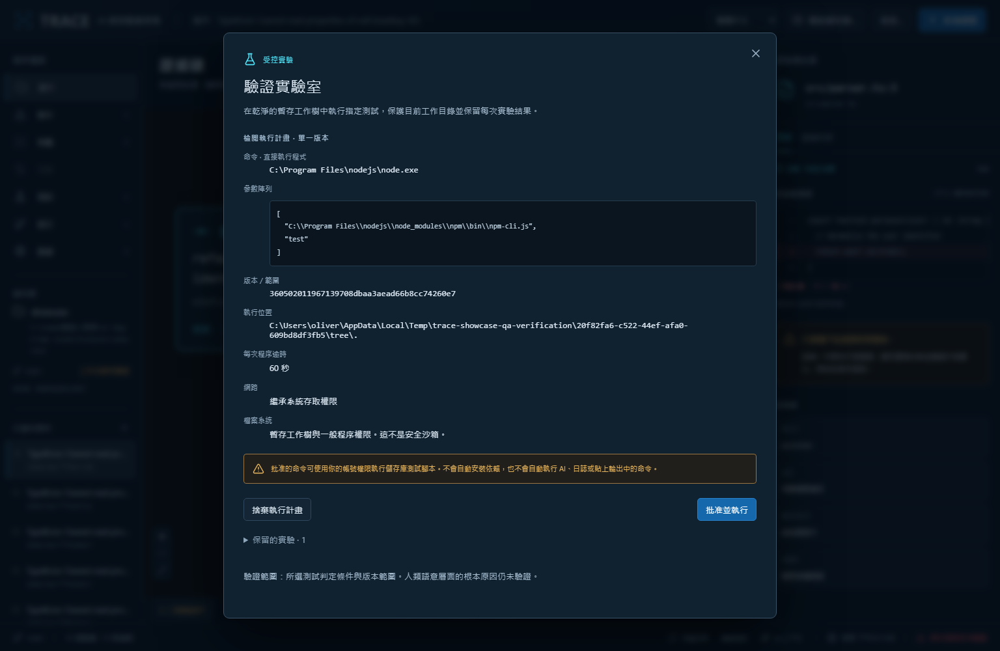
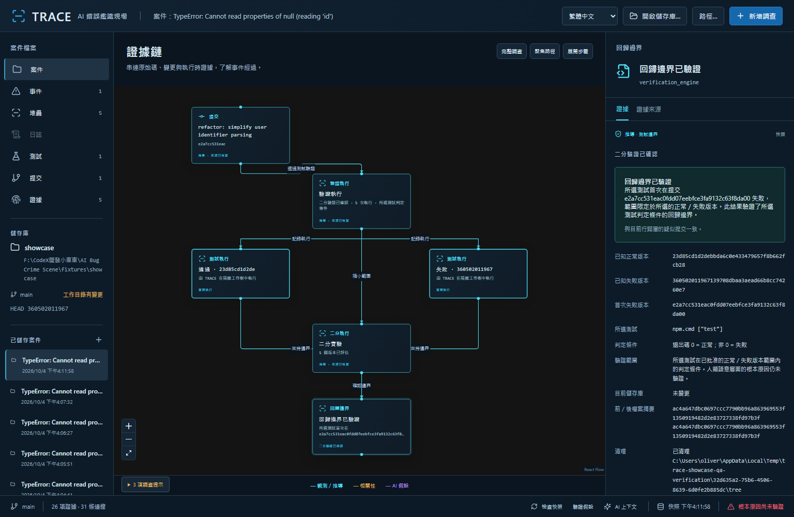
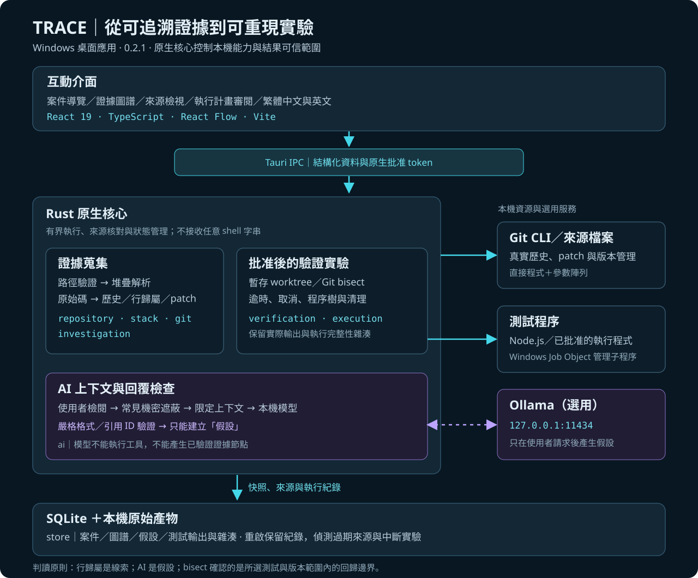

# TRACE — AI 錯誤鑑識現場

**從錯誤堆疊追到原始碼與版本變更，再透過實際測試驗證回歸邊界。**

TRACE 是以本機執行為核心的 Windows 桌面開發工具，針對 JavaScript、TypeScript 與 Node.js 專案，將分散在錯誤訊息、原始碼、Git 歷史與測試中的線索整理成可互動的證據圖譜。AI 可以協助提出假設，但不能取代實際證據，也不能自行執行命令。

目前版本：**0.3.0** · **繁體中文／英文介面** · **React + TypeScript + Tauri + Rust**

[操作示範](#操作示範從線索走向驗證) · [系統架構](#系統架構與技術選擇) · [測試與驗證](#測試與驗證) · [本機執行](#本機執行與打包)

**快速導覽：** 圖 1 看操作介面，圖 3 看實際驗證結果，圖 4 看架構；[中文示範指南](docs/SHOWCASE.md) 可用於現場展示，[開發歷程](#開發歷程與實作來源) 可核對功能如何逐步完成。



*圖 1｜實際示範案件。中央將事件、堆疊框架、原始碼位置、行歸屬、提交與 patch 串成證據鏈；右側保留原始程式碼，並標示堆疊指向的行與欄。英文錯誤訊息與程式碼是原始證據，刻意不翻譯。*

## 專案動機

除錯常需要在終端機、編輯器、Git 歷史與 AI 對話之間反覆切換。即使找到最後修改某行程式碼的提交，也不能直接認定它是錯誤原因；AI 提出的解釋同樣可能缺乏可重現的依據。

TRACE 要處理的問題是：**如何把「看起來合理的解釋」轉成「可以追溯來源、可以實際檢驗的調查流程」？**

這個專案將軟體工程、版本控制與人機互動整合到同一個桌面工具中。設計重點除了呈現結果，也包括揭露結果如何產生、哪些內容只是推論，以及驗證的適用範圍。

## 核心功能

### 0.3.0：案件搜尋與調查報告

左側已儲存案件可用標題或案件 ID 搜尋，多個關鍵字會同時比對；清除搜尋後可回到完整清單。側欄選取狀態會跟隨目前證據，測試與驗證節點也納入對應分類。

開啟案件後，選擇底部「匯出報告」，先檢閱內容，再下載 HTML 或 Markdown。報告包含案件概覽、證據清單、連線與保留的實驗結果；HTML 可離線閱讀與使用瀏覽器列印。語言跟隨目前介面，匯出不會執行測試或呼叫 AI。

原始證據摘錄預設不勾選，分享前可自行決定是否加入程式碼、日誌與模型內容。原生批准 token、程序環境與內部 run JSON 不會直接序列化到報告；HTML 會跳脫原始文字，Markdown 則以足夠長的程式碼圍欄包住內容。摘要仍可能含案件標題與測試命令，分享前請先檢閱。這是展示用報告，不是可匯入還原的案件備份。

報告會保留結果的版本範圍與測試判定條件；案件已過期或紀錄完整性無效時，不將歷史結果標為目前有效的回歸邊界。



*圖 5｜0.3.0 原生 WebView2 桌面截圖。畫面已主動勾選原始摘錄，預覽先列出案件、快照與適用範圍；HTML 與 Markdown 均已實際下載。未執行新實驗的案件仍顯示「根本原因尚未驗證」。*

| 功能 | 使用者可以做什麼 | 設計重點 |
|---|---|---|
| 錯誤堆疊解析 | 貼上 Node.js 錯誤與堆疊，定位實際來源行 | 支援 Windows 路徑、空白與百分比編碼的檔案 URL；無法解析時保留提示 |
| Git 證據蒐集 | 查看行歸屬、檔案歷史、提交資訊與實際 patch | 使用真正的 Git 輸出，不以 AI 補造證據 |
| 互動式證據圖譜 | 選取節點、聚焦路徑、展開框架或測試步驟 | 以文字、顏色與線型區分觀測、推導、相關性及 AI 假設 |
| 證據來源檢視 | 檢查原始摘錄、命令參數、時間、提交 SHA 與雜湊 | 每項證據保留可檢視的來源資料 |
| 驗證實驗室 | 審閱並批准測試，在不同提交上重現行為 | 使用暫存 Git worktree，保留執行輸出、狀態與清理結果 |
| 回歸邊界定位 | 選定正常與失敗版本，執行真正的 Git bisect | 找出所選測試首次失敗的提交，不宣稱已證明所有情境的根本原因 |
| 本機 AI 假設 | 檢閱上下文後，使用 Ollama 產生有引用的假設 | 固定連到本機服務；未知證據 ID 或不符合格式的回覆會被拒絕 |
| 案件保存與雙語介面 | 重啟後開啟案件；自由切換繁體中文／英文 | SQLite 保存快照；語言設定另存於本機，原始證據維持原文 |
| 案件搜尋與報告匯出 | 依標題／ID 找案件，預覽後下載 HTML／Markdown | 分開處理摘要與原始摘錄，不執行新實驗、不直接匯出原生內部資料 |

### 證據與推論如何區分？

| 類型 | 例子 | 能支持的結論 |
|---|---|---|
| 觀測 | 使用者貼上的錯誤堆疊、日誌或測試輸出 | 有這份輸入；不代表 TRACE 已執行其命令 |
| 推導 | 從檔案與 Git 取得的原始碼、行歸屬與 patch | 來源與變更可核對；行歸屬本身不證明因果 |
| 相關性 | 與事件相關的變更線索 | 值得調查，但尚未經實驗確認 |
| AI 假設 | 模型提出的解釋與驗證建議 | 供人檢查的推論，不是已確認事實 |
| 實驗結果 | 實際測試輸出與 bisect 邊界 | 在指定版本範圍內，所選測試的行為發生變化 |

## 操作示範：從線索走向驗證

示範資料由 `npm run fixture` 建立，包含三個真實 Git 提交：正常版本、移除空值防護的回歸版本，以及後續文件提交。測試與堆疊均來自實際執行，並非模擬輸出。

案例的關鍵變更如下；此摘錄對應示範儲存庫中兩個版本的實際程式碼：

```diff
 export function parseUser(user: { id: string } | null) {
-  if (!user) return null;
-  return user!.id;
+  // Normalize the user identifier
+  return user!.id.trim();
 }
```

TypeScript 的 `!` 不會在執行時檢查空值。移除防護後，`parseUser(null)` 在存取 `id` 時發生例外。示範測試同時檢查「空值應回傳 null」與「有效使用者保留 ID」，讓版本比較依據明確的行為判定，而非提交訊息或 AI 猜測。

### 1. 從錯誤建立調查案件

開啟 `fixtures/showcase`，貼上 `evidence/stack.txt`，再建立證據圖譜。TRACE 會定位到 `src/parser.ts:3` 的 `return user!.id.trim();`。查看行歸屬與 patch，可以看到原先的 `if (!user) return null;` 被移除。

這只能形成候選線索：**最後修改該行的提交，仍需要測試驗證。** 圖 1 的原始碼檢視器因此持續顯示「行歸屬不能證明因果關係」。

### 2. 審閱執行計畫，再批准實驗

選擇「驗證假設」，輸入執行程式 `npm.cmd`、參數 `["test"]`、工作目錄 `.` 與逾時秒數。TRACE 先顯示解析後的程式、參數、提交、暫存位置與權限；只有按下「批准並執行」才會開始測試。



*圖 2｜執行前的審閱畫面。`npm.cmd` 解析為已安裝的 Node.js 與 npm CLI，參數以陣列傳遞。AI 回覆、日誌與貼上的輸出不會自動成為可執行命令。*

測試在乾淨的暫存 worktree 中執行。TRACE 記錄 stdout、stderr、退出碼、時間與雜湊，並比較原工作目錄在執行前後的 HEAD、分支、狀態及非忽略檔案摘要。逾時、取消與啟動錯誤不會被當成失敗版本。

### 3. 找出可重現的回歸邊界

先確認目前失敗版本，再從 `evidence/manifest.json` 取得 `good` 的完整 SHA，確認正常版本通過。最後審閱並批准二分驗證。TRACE 重新測試端點、執行 Git bisect，並保留候選版本與邊界確認的實際測試紀錄。



*圖 3｜找到真正移除空值防護的提交 `e2a7cc531eac0fdd07eebfce3fa9132c63f8da00`。右側呈現正常／失敗版本、所選測試、驗證範圍與清理結果；底部仍保留「根本原因尚未驗證」。*

結果確認的是**特定測試在指定版本範圍內的回歸邊界**。測試覆蓋是否足以解釋正式環境事件，仍需要人進一步判斷。完整流程見 [操作與示範紀錄](docs/SHOWCASE.md)。

## 系統架構與技術選擇



*圖 4｜實線表示核心流程，紫色虛線表示使用者主動啟用的 AI 輔助路徑。模型內容必須通過原生端格式與引用檢查，才會成為假設節點。*

| 層次 | 技術／模組 | 為什麼這樣設計 |
|---|---|---|
| 操作與視覺化 | React 19、TypeScript、Vite、React Flow | 將案件、圖譜與證據檢視分開，支援逐步探索與雙語呈現 |
| 桌面橋接 | Tauri 2、結構化 IPC | 分離呈現層與本機能力；介面不提交任意 shell 字串或 Git 參數 |
| 原生分析 | Rust：`repository`、`stack`、`git`、`investigation` | 驗證路徑、解析堆疊、讀取真實來源並建立證據節點 |
| 實驗執行 | Rust：`verification`、`execution`；Git worktree／bisect | 管理批准、逾時、取消、清理與狀態保存；Windows Job Object 管理子程序生命週期 |
| 本機 AI | Rust：`ai`；Ollama | 限制上下文、遮蔽常見機密並檢查回覆格式與引用，不授予模型工具執行能力 |
| 案件持久化 | Rust：`store`；SQLite | 保存快照與實驗紀錄，重啟後核對來源變化與原始內容 |

目前採用針對性讀取，沒有全儲存庫索引。分析最多解析八個框架，每次檔案歷史查詢最多十二筆近期提交；Git 鑑識優先處理第一個成功定位的來源，其餘框架保留原始碼證據與提示。詳見 [架構](docs/ARCHITECTURE.md)、[證據模型](docs/EVIDENCE_MODEL.md) 與 [驗證引擎](docs/VERIFICATION_ENGINE.md)。延伸技術文件目前保留英文。

## 工程實作與研究延伸

這個作品可展示的工程能力包括：

- **跨語言系統整合**：TypeScript 互動介面與 Rust 本機核心，透過明確的 IPC 邊界銜接。
- **可追溯的資料設計**：分開保存輸入、來源、推論與執行結果，讓圖譜主張能回到原始內容核對。
- **程序與故障復原**：處理批准、逾時、取消、子程序終止、暫存目錄清理與中斷後的恢復狀態。
- **可重現的驗證流程**：以真實 Git 儲存庫與程序建立回歸案例，透過單元、端對端及桌面操作交叉驗證。

若作為研究所推甄作品，可從「AI 輔助除錯的可信度」與「可視化證據如何影響使用者判斷」延伸研究。例如，設計對照實驗，量測有無證據圖譜時的定位時間、錯誤歸因率與使用者信心，或比較不同模型引用證據的正確率。

**上述量測屬於後續研究方向，目前尚未進行使用者研究，也沒有宣稱工具能提升多少除錯效率。**

| 可延伸的研究問題 | 可設計的評估方式 | 目前狀態 |
|---|---|---|
| 證據圖譜是否降低錯誤歸因？ | 以相同案例比較一般工具與 TRACE，記錄定位時間與正確率；交錯安排使用順序 | 待設計與招募受試者 |
| 揭露來源是否改善信心校準？ | 比較使用者對正確與錯誤假設的信心，以及回查原始證據的行為 | 尚未量測 |
| 本機模型能否穩定引用正確證據？ | 固定證據包與模型版本，人工標註引用相關性與事實正確性；另統計格式拒絕率 | 已有格式／引用 ID 檢查，尚未做模型比較研究 |

通過格式檢查只代表回覆能被系統接受，**不代表內容在語意上正確**。實驗設計仍需區分格式、引用與解釋品質。

> **作品集摘要｜可搭配截圖使用**
>
> TRACE 是結合版本控制、AI 輔助推論與可重現測試的 Windows 桌面除錯工具。系統將錯誤堆疊、原始碼、Git 變更與測試紀錄呈現為互動式證據圖譜，並以 Rust 原生核心管理來源追溯、實驗批准、暫存工作樹及案件保存。本機 AI 僅提供帶有證據引用的假設；實際 Git bisect 結果則限定於指定測試與版本範圍，呈現工程實作與推論可信度之間的明確界線。

## 測試與驗證

**0.3.0 本次驗證（2026-10-11）：**

| 驗證項目 | 結果與範圍 |
|---|---|
| 前端單元測試 | 18 項通過，涵蓋語言、案件搜尋、原始摘錄選項、HTML 跳脫、Markdown 圍欄及過期／無效結果 |
| 端對端測試（分批執行） | 7 個案例通過；涵蓋真實 Git、雙語批准與 bisect、保存、取消／逾時、搜尋及兩種報告下載。Ollama 未啟動，1 個實際 AI 推論案例略過 |
| 原生桌面報告 | 直接啟動 0.3.0 的 Tauri／WebView2 成品，核對內嵌前端版本，實際下載 HTML 與 Markdown；預覽、Escape 關閉及控制台檢查通過 |
| 正式建置 | TypeScript／Vite 與 Windows x64 NSIS 安裝包建置成功 |

中文版 bisect 最初在同時進行原生編譯時遇到 Git 準備／啟動逾時；程式保留失敗狀態並完成清理，沒有誤標為已確認。編譯完成後單獨重跑，正常／失敗版本與預期回歸提交均確認通過。這次未修改 Rust 驗證核心，也未重新執行下列歷史 Rust 測試。

下表整理 **2026-10-04 的歷史驗證**，與本次結果分開記錄。

| 驗證項目 | 已完成的結果 | 紀錄範圍 |
|---|---|---|
| Rust 核心測試 | 78 項通過，包含真實 Git、程序生命週期與驗證完整性 | 0.2.0／Phase 1.1 驗收紀錄 |
| 前端單元測試 | 11 項通過，包含語言保存、翻譯範圍與原始證據保護 | 0.2.1 雙語介面開發 |
| 端對端測試 | 7 個案例通過，包含實際測試、bisect、取消／逾時與雙語切換 | 0.2.1；使用相同 Rust 核心的測試傳輸介面 |
| Windows 桌面操作 | 實際 Tauri IPC、案件保存與程序重啟已驗證；0.2.1 重啟後保留語言 | 原生 WebView2，另於瀏覽器測試之外執行 |
| 正式打包 | TypeScript／Vite 建置與 Windows x64 NSIS 打包成功 | 0.2.1 |

0.2.0 的完整 [驗收紀錄](docs/VALIDATION.md) 包含 23 個驗收項目，以及工作目錄前後比較、中斷復原與邊界確認。該文件是當時的歷史紀錄，其 88 項測試總數與 private 倉庫描述不代表目前版本或可見性；本倉庫現已公開，保留原始提交歷史。

截圖中的圖譜、批准面板與回歸邊界來自 **0.2.1 正式前端搭配真實 Rust 核心**的端對端流程。測試傳輸介面僅供開發驗證，沒有隨桌面程式出貨；Git 與測試程序的結果不是預先偽造的輸出。

### 已知限制

- 目前聚焦 JavaScript／TypeScript／Node.js 堆疊；尚未實作 source map 還原、AST 符號對應與日誌時間序列分析。
- 來源摘錄是蒐集當下的快照，不保證是正式環境部署版本；重新開啟案件或「檢查快照」會核對來源變化。
- 暫存 worktree 提供版本與工作目錄隔離，**不是安全沙箱**。已批准的測試仍繼承使用者的網路與檔案權限；忽略檔案與外部檔案系統副作用不在來源摘要檢查範圍內。
- 本機模型品質因模型而異，信心標籤與引用不能取代因果驗證。
- Windows 安裝檔尚未簽署，尚未驗證乾淨機器上的安裝流程。

詳見 [安全與執行規則](docs/SECURITY.md)。

## 開發歷程與實作來源

本倉庫保留原始提交歷史，從本機鑑識、介面調整，到實驗驗證與雙語呈現逐步演進；下列連結可直接核對代表性變更。

| 里程碑 | 代表性提交 | 可查看的成果 |
|---|---|---|
| 本機鑑識與證據工作區 | [`ed5b66e`](https://github.com/oliverchenOVO/project-trace/commit/ed5b66e) | 儲存庫、堆疊、Git 與互動介面的整合 |
| 真實回歸案例與證據測試 | [`7a826de`](https://github.com/oliverchenOVO/project-trace/commit/7a826de) | 以實際 Git 歷史建立可重現案例 |
| Windows 展示版本 | [`90612dd`](https://github.com/oliverchenOVO/project-trace/commit/90612dd) | 桌面打包與展示驗證 |
| 經批准的測試與回歸定位 | [`d16a542`](https://github.com/oliverchenOVO/project-trace/commit/d16a542) | 暫存 worktree、實際測試與 bisect |
| 完整性與生命週期修正 | [`adfe3db`](https://github.com/oliverchenOVO/project-trace/commit/adfe3db) | 中斷、清理、並行更新與證據一致性 |
| 繁體中文／英文介面 | [`9bafb53`](https://github.com/oliverchenOVO/project-trace/commit/9bafb53) | 語言切換、偏好保存與雙語回歸測試 |

若希望深入檢查實作，可從以下檔案開始：

| 審閱重點 | 實作與測試入口 |
|---|---|
| 示範如何產生真實提交與失敗輸出 | [案例產生器](scripts/create-fixture.mjs) |
| 批准、測試、bisect 與保存狀態 | [驗證服務](src-tauri/src/verification.rs)、[程序執行](src-tauri/src/execution.rs) |
| AI 上下文與回覆檢查 | [本機 AI 模組](src-tauri/src/ai.rs) |
| 圖譜與原始證據呈現 | [證據圖譜](src/features/graph/EvidenceGraph.tsx)、[檢視器](src/features/source/Inspector.tsx) |
| 語言切換是否保留證據與驗證結果 | [雙語端對端測試](tests/e2e/language.spec.ts) |

## 本機執行與打包

### 環境需求

Windows x64、Node.js 24 以上、Git、穩定版 Rust MSVC、Visual Studio C++ Build Tools 與 WebView2；不需要 WSL。請確認 Cargo 位於 PATH，必要時在 PowerShell 執行：

```powershell
$env:PATH = "$env:USERPROFILE\.cargo\bin;" + $env:PATH
```

### 開發與示範資料

```powershell
npm ci
npm run fixture
npm run tauri -- dev
```

右上角可選繁體中文或英文。第一次預設跟隨環境語言；選擇會保存，若偏好儲存不可用，當次切換仍可運作。

`npm run dev` 僅提供瀏覽器畫面預覽，本機儲存庫操作需要桌面程式。案件存於應用程式資料目錄的 `cases.sqlite`，不寫入被調查的儲存庫。

### 選用本機 AI

先啟動 Ollama，確認已有安裝的模型。在案件中選擇「AI 上下文」，檢查遮蔽後的證據內容、輸入模型名稱，再選擇「產生假設」。TRACE 固定連到 `127.0.0.1:11434`，不保存 API 金鑰，也不會自動將儲存庫送往遠端 AI 服務。

### 執行測試

```powershell
npm test
npm run test:native
cargo build --manifest-path src-tauri/Cargo.toml --no-default-features --bin trace-probe
npx playwright install chromium
npm run build
npm run test:e2e
```

端對端測試在 `127.0.0.1:24917` 提供正式前端與測試用 IPC 轉接。若要一併驗證真正的 AI 推論，可先將 `TRACE_AI_MODEL` 設為已安裝的 Ollama 模型名稱。

### 產生 Windows 成品

```powershell
npm run tauri -- build
```

執行檔位於 `src-tauri/target/release/TRACE.exe`，NSIS 安裝檔位於 `src-tauri/target/release/bundle/nsis/`。目前 GitHub 尚未建立 Release，請依上述方式自行建置；本機產出路徑不是線上下載連結。

## 文件與配圖

| 文件 | 用途 |
|---|---|
| [架構說明](docs/ARCHITECTURE.md) | 模組職責、IPC、資料保存與驗證引擎 |
| [證據模型](docs/EVIDENCE_MODEL.md) | 節點、連線、來源與可信狀態 |
| [驗證引擎](docs/VERIFICATION_ENGINE.md) | 批准、程序管理、清理與結果適用範圍 |
| [安全規則](docs/SECURITY.md) | 路徑、輸入、模型與程序的限制 |
| [完整示範](docs/SHOWCASE.md) | 真實回歸案例、案件搜尋與報告匯出的逐步操作 |
| [歷史驗收紀錄](docs/VALIDATION.md) | 已執行檢查與保留的驗證資料 |
| [配圖來源與使用說明](docs/media/README.md) | 截圖來源、架構圖與個人網頁引用方式 |

本 README 與配圖可作為個人網頁的專案介紹素材。圖檔保存在倉庫內，GitHub 閱讀不依賴本機暫存路徑；架構圖另附 PNG 版本，方便放入推甄簡報或文件。
